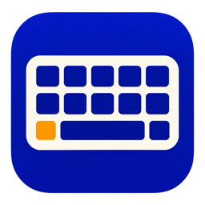

# KeyDuty

[English](README.md) | **日本語**

いつものキーボードを、自分の使い方に合わせて。

KeyDutyは、よく使う操作を好きなキーに割り当てられるmacOSのメニューバーアプリです。キーをひと押しして入力を切り替えたり、押しやすい位置にキーを移したり、音楽を一時停止したりできます。

初期設定では、**左Command**の単押しで**英数**、**右Command**の単押しで**かな**を送信します。いつものCommandショートカットも、そのまま使えます。

## できること

- **修飾キーの単押しを活用。** Command、Shift、Control、Option、Fn / 地球儀の単押しに、よく使うキーや操作を割り当てられます。
- **押しやすいキーに変更。** キーを別のキーに置き換えたり、修飾キーとの組み合わせで操作を呼び出したりできます。
- **押す・離すに別々の操作。** キーを押したときと離したとき、それぞれに操作を割り当てられます。
- **日常の操作を手元に。** 画面ロック、画面のオフ、スリープ、スクリーンセーバーの開始、メディアの再生・一時停止をキーから実行できます。
- **入力が途切れたらキーを自動送信。** 送信するキーと、5〜300秒の待ち時間を設定。最後にキーを押してから指定時間が経過すると、設定したキーを1回送信します。
- **キーボードに合わせて使い分け。** 割り当てごとに対象から除外するキーボードの機種を選び、使う環境に合わせて調整できます。

設定は自動で保存されます。ログイン時の自動起動を有効にすれば、Macを使い始めるときからKeyDutyを利用できます。

## はじめ方

**macOS 14以降**に対応しています。

1. メニューバーのアイコンから**設定…**を開きます。
2. **一般**で入力監視とキーイベント送信を許可し、**権限を確認**をクリックします。
3. **キー設定**で**追加**をクリックし、入力キーと割り当て先を選びます。キーは一覧から選ぶか、実際に押して記録できます。

初期設定の英数・かな切り替えを使う場合は、macOSに日本語の入力ソースを追加してください。キーの自動送信を試す場合は、**自動送信**を有効にして待ち時間とキーを選びます。

表示言語は**日本語と英語**から選べます。**一般 → 表示言語**で切り替えるか、システム設定に合わせて使えます。変更はその場で反映されます。

## ライセンス

[MIT License](LICENSE)。
