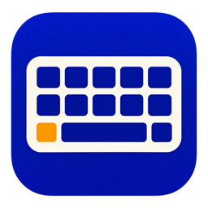

# KeyDuty

**English** | [日本語](README.ja.md)

**Make your keyboard work the way you do.**

KeyDuty is a macOS menu bar app that puts the actions you use most on the keys you choose. Switch input modes, move hard-to-reach keys, lock your screen, or pause music, all with a single key.

Right out of the box, tapping **Left Command** sends **Eisu (英数)** and tapping **Right Command** sends **Kana (かな)**, so you can switch Japanese input on a US keyboard just like on a JIS keyboard. Shortcuts like `⌘C` and `⌘V` keep working as usual.

## Ideas to get you started

- **Switch Japanese input on a US keyboard.** Tap Left or Right Command to switch modes without leaving the home row.
- **Lock your screen with one key when you step away.** Give a rarely used key like Right Option a tap action for locking the screen or sleeping your Mac.
- **Remap only your external keyboard.** Exclude keyboard models per assignment, so your MacBook's built-in keyboard stays as it is while your external keyboard works your way.
- **Return to Eisu when you stop typing.** Send a key automatically after a pause. Send Eisu, for example, and your next sentence starts in English input mode.

## Features

### Tap actions for modifier keys

Run a key or action when you press and release Command, Shift, Control, Option, or Fn / Globe on its own. When you use a modifier together with another key or the mouse, KeyDuty doesn't treat it as a tap, so your usual shortcuts aren't affected.

### Remaps and key combinations

Remap one key to another, or trigger an action with a combination like `⌃⌥L`. On keyboards that report them, Fn and media keys can be used as inputs too.

### Separate actions for press and release

Assign one action for when a key goes down and another for when it comes up. You can also set either side to do nothing.

### Mac controls on your keyboard

Lock the screen, turn off the display, sleep, start the screen saver, or play and pause media. Play and pause are separate actions, so you always know which one you'll get.

### Send a key after inactivity

Send a key of your choice once, 5–300 seconds after your last key press. Mouse movement and auto-repeat don't reset the timer, so the key is sent when you've actually stopped typing.

### Per-keyboard assignments

Exclude keyboard models from individual assignments. Exclusions are saved by model, so they apply again automatically when you reconnect a keyboard.

### Easy setup

Search keys by name or press a key to record it. Symbol keys show both their US and JIS names. Settings save automatically, and KeyDuty can launch at login. The interface is available in **English and Japanese**, and switching languages takes effect immediately.

## Getting started

For **macOS 14 or later**.

1. Open **Settings…** from the menu bar icon.
2. In **General**, allow **Input Monitoring** and **Keyboard Event Posting**, then click **Check permissions**.
3. In **Key Settings**, click **Add** and choose an input and its destination.

For the default Eisu/Kana setup, add a Japanese input source in macOS. To send a key after inactivity, turn it on in the **Auto Send** tab and choose a delay and key.

## License

[MIT License](LICENSE)
